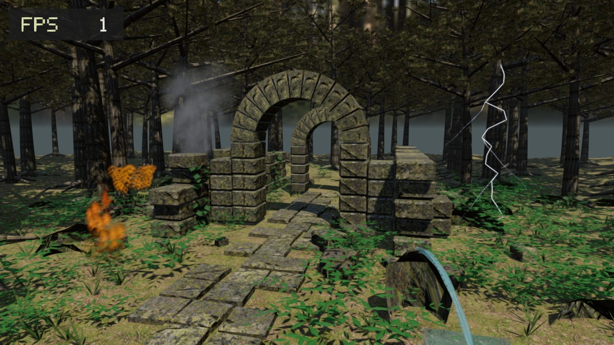

# Forest Ruins — Filament + SDL3

Native C++ forest-and-ruins scene for **Android arm64**, using **SDL 3.4.18** for
window/input/lifecycle and **Filament 1.78.1 from our pinned fork** for switchable OpenGL ES / Vulkan rendering.



This preview is an actual Filament render at 1280×720, using the same scene and materials.
It is not an Android screenshot or an FPS benchmark. The visible FPS is measured on the
Linux software renderer, not a phone.

## Scene

- Two stone arches, broken walls, beveled masonry, scattered rubble and an uneven stone path.
- Undulating forest floor, branching trees with exposed roots, folded individual leaves, ferns and ivy.
- Photograph-based masked pine-sprig canopy cards, with crossed planes for view independence.
- Photograph-based 1K PBR ground, mossy stone and bark maps: albedo, OpenGL normals and AO/roughness/metalness.
- Forest HDR environment, prefiltered reflections, diffuse spherical harmonics, warm directional sunlight,
  three shadow cascades, SSAO, height fog, restrained bloom, temporal anti-aliasing and animated foliage.
- A sunward opening in the canopy lets direct sunlight reach the arches and stone path;
  reduced ambient light and thinner fog preserve the contrast between sunlight and tree shadows.
- Top-left FPS overlay also shows the active GPU backend (`GL` / `VK`). Tap that overlay
  to switch backend without exiting the app, or press `V` on a connected keyboard. The
  renderer is fully destroyed and recreated before switching; camera position and the
  animation clock are preserved. OpenGL ES remains the default on app launch. If Vulkan
  initialization fails, the error is reported rather than substituting OpenGL ES.
  Render backend initialization is also printed to Android logcat.
- FPS updates every half second from submitted frames. Skipped frames count
  as elapsed time; backgrounding and surface changes reset the measurement.
- Deterministic generation with spatial/material batching and frustum culling; approximately
  386,000 triangles, 232 batches and about 40 MiB of GPU vertex/index data before driver overhead.
  Texture data is about 25.3 MiB including mipmaps on ASTC/BC7/ETC2 hardware, plus environment maps
  and render targets. Normal maps remain uncompressed; albedo, AO/roughness and canopy use UASTC KTX2.
- One finger rotates the camera around the ruin; two fingers pinch to zoom. Mouse drag/wheel also work.
  This is an orbiting scene viewer; it does not include walking physics or collision detection.
- Five separated effects: continuous fire and embers at the front left, a repeating explosion on
  the left, an animated water jet and flowing sheet at the front right, branching double-strike
  lightning on the right, and a dense drifting smoke column behind the ruins.
  Fire, explosion and lightning use localized colored Filament point lights that visibly
  illuminate the stone ruins and ground at the scene's daylight exposure. The warm fire
  flickers continuously, the explosion casts a fast-fading orange flash, and the blue-white
  lightning lights the ruins at both strike pulses. Point-light shadow maps remain disabled
  to avoid the substantial mobile GPU cost. Explosion repeats every 5.4 seconds;
  lightning every 4.8 seconds. These are visual effects without damage or fluid physics.
  The effects add 583 animated quads (1,166 triangles), six batches and about 126 KiB of vertex/index
  data; buffers keep fixed capacity while visible positions update with time and the camera.
  Fully transparent explosion and lightning batches skip geometry generation, uploads and draws.
- Assets are bundled in the APK. No network connection is needed while viewing the scene.

The visual target is a realistic forest ruin. Architecture and vegetation are procedural geometry;
this does not contain scanned buildings or production-quality scanned tree models. Actual image
quality and frame rate must be evaluated on the target phone.

## Compare OpenGL ES and Vulkan

Install the single signed APK. It contains both API versions of the custom Filament shaders
(compiled with matching `matc -a opengl -a vulkan -p all`) and the same textures and
procedural geometry. Tap the upper-left `FPS ... GL` overlay to switch to Vulkan,
which then appears as `FPS ... VK`. Tap again to return to OpenGL ES. The overlay
is clickable with touch or mouse; a physical keyboard can also switch with `V`.

The Vulkan test requires a device with a working Vulkan driver. Do not treat a Vulkan
initialization failure as a valid comparison result. The error is shown on screen and in
logcat, and no fallback changes the requested test backend.

Vulkan explicitly enables Filament's shared material-uniform batching through
`RendererEngine.h`. The fork SDK and native APK use LTO. SDK metadata must match both
the source commit and LTO setting; unsupported LTO fails configuration. Scene geometry,
lighting, effects and postprocessing are unchanged.

Filament 1.78.1 also retries `VK_SUBOPTIMAL_KHR` in its image-acquisition loop and can
skip presentation indefinitely when the driver repeatedly returns it (as seen in the tablet's
earlier log). This is a separate SDK defect, not an established cause of the tablet fault. Vulkan defines this result as a successful acquisition of a usable image.
`SwapPlatform.h` uses that image, including its original index and readiness semaphore;
out-of-date and error results remain unchanged. Filament still detects size changes and
recreates the swapchain. The supplied Android platform is owned until the engine is destroyed.
See the [Vulkan acquisition result contract](https://docs.vulkan.org/refpages/latest/refpages/source/vkAcquireNextImageKHR.html).

For repeatable FPS measurements, wait after each switch for shaders to warm up, use
identical camera positions and scene conditions, and record multiple runs in each
backend. This demo retains automatic dynamic resolution (65–100% per axis) by default:
FPS alone cannot establish the faster renderer when the backends choose different
internal resolutions. For a same-resolution comparison, select `fixed_resolution`
in **Actions → Android test build**. That one APK renders both backends at fixed
100% resolution, with the same geometry, effects, shadows and postprocessing.
Leave `vulkan_sync` and `vulkan_validation` unchecked for performance runs.

Every two seconds, Android logcat prints a `ForestPerf` line containing the backend,
resolution mode, surface size, last scene resolution scale, reported display refresh
rate, submitted FPS, submission-interval p50/p95, average app submission time, rejected
`beginFrame()` attempts, and the latest completed Filament frame's main-thread,
backend-thread and GPU elapsed times. GPU timers that are unavailable are printed as
`n/a`. These latest-frame values are not interval averages. Submission intervals include
skipped attempts, event processing and pacing; they are not actual display presentation
times or a GPU-only benchmark. The scene scale is read after rendering the main view;
it does not describe the separate HUD or every postprocessing attachment's dimensions.
Each interval keeps at most 512 submission-interval samples. Backgrounding, surface,
size and backend changes reset statistics. Capture with:

```sh
adb logcat -v threadtime -s SDL
```

The app supplies SDL's current display refresh rate to Filament and updates it on
display/foreground events. Unknown refresh rates are explicitly reported; no guessed
60 Hz value is substituted. Rejected frames back off for 1 ms before retrying, without
rebuilding animations or uploading effects. This is a retry backoff, not an Android
Choreographer vsync callback. Camera/projection state is updated only when it changes.

Effect vertices reuse a bounded pool of completed CPU upload arrays. Every submitted
batch retains its storage until Filament's buffer-release callback; arrays never use a
frame-count guess to determine whether they are safe to overwrite. Particle sorting
uses stable index merges with cached distances and stack scratch. Geometry, particle
ordering, vertex attributes and shader precision are preserved.

## Performance

### GPU bandwidth (0.2.1)

The seven albedo, AO/roughness and canopy textures are prepared as UASTC/Zstd KTX2 with complete
1024→1 mip chains. `Ktx2Reader` chooses supported native blocks (ASTC 4×4, BC7, then ETC2), with
RGBA8 used only on hardware without a supported compressed target. Color textures retain sRGB
metadata; AO/roughness is linear. The three normal maps retain their exact RGBA8 source and existing
runtime mip generation. With 8-bit-per-pixel native blocks, texture storage including mipmaps falls
from about 53.3 MiB to 25.3 MiB (52.5%). This is a storage estimate, not a measured FPS improvement.
UASTC/native block encoding is lossy and can introduce small texture differences; normal-map detail
is not compressed.

Static GPU vertices now use normalized signed 16-bit tangent quaternions and half-float colors.
Positions and UVs stay float32 and are copied exactly; half colors preserve stone tints above 1.0.
The 1,101,542 generated vertices occupy 39,655,512 instead of 57,280,184 bytes (30.8% less).
The packing check measured maximum color error 0.000484347 and tangent component error
0.0000152886, with handedness preserved. Index buffers, triangle order, geometry and batching remain
unchanged.

The five particle kinds specialize the same material package using Filament material constants,
letting each GPU program remove unrelated effect branches. The existing high-precision integer
noise, emission/exposure handling, alpha cutoff, animation and point-light behavior remain.
Fifteen GLES fragment readbacks (five kinds at three times, including one hour) matched the
previous uniform-driven shader with zero RGBA8 difference in the Mesa harness.
No SSAO, bloom, fog, TAA/FXAA, shadow cascade, shadow resolution, vegetation animation or render-scale
setting is reduced. Full renderer and tablet FPS/visual validation are still required.

### Vulkan pipeline lifetime

The tablet validation report identified `VUID-vkDestroyPipeline-pipeline-00765`:
Filament 1.78.1 evicted a pipeline while submitted command buffers still used it.
The earlier fix waited for device idle before an eviction batch; its source is recorded
in commit `80031464b6e224b4bfc89c4eb4933ee639e40059`. The historical APK is no longer
available in the current releases. Normal builds replace the rolling `test-build` APK
without attempting to archive that historical binary.

This branch builds complete SDKs from [edward9s/filament](https://github.com/edward9s/filament),
pinned by full commit SHA in `filament.json`. Each pipeline now uses Filament's existing
`resource_ptr` ownership: the cache and each command buffer hold references. Eviction drops
only the cache reference; a command buffer releases its references after its existing fence
reports completion. No queue/device idle wait is added to pipeline collection. The SDK
also carries the previously tested protected-queue capacity and Vulkan 1.1 feature-chain fixes.

The application no longer compiles replacement Filament translation units against an
official prebuilt library. Host tools, Linux libraries and Android libraries come from
the same fork commit. [SDK build and pin details](docs/filament-sdk.md).

The new ownership change still needs tablet validation. In **Android test build → Run
workflow**, select `feature/filament-fork-sdk`, check `vulkan_validation` and leave
`vulkan_sync` unchecked. Switch to Vulkan, exercise rotation and background/resume,
and generate an interactive bugreport ZIP. Include whether the scene rendered correctly.
After this passes, build with both options unchecked for performance measurement.
Validation adds a large native layer and affects timing, so its APK is unsuitable for FPS
comparison. Both options together are rejected because waiting can hide the fault.

Vulkan material uniform batching and SDK/application LTO are enabled. Compare the new
APK with both diagnostics OFF after shaders warm up, using the same camera and scene.
Tablet measurements determine the resulting frame times.
Qualcomm and surface-rotation advisories remain visible. Scene quality is unchanged.

Static batches share only bit-identical vertices and use 16-bit indices. Triangle order, UVs,
tangent frames and colors are preserved. The earlier compaction reduced CPU mesh payload from 64,784,496 to 59,593,916
bytes (8.0%); batches that exceed the 16-bit vertex limit fail early. Vertex indexing adds
one-time CPU work during scene loading; it does not run each frame. Particle shaders reject
transparent borders before evaluating noise. Unlit particles do not rebuild unused tangent frames.

The CPU effect benchmark reuses warmed storage, simulates 1,800 frames per trial and reports the median of seven trials.
A Linux comparison measured 103.2 → 68.7 µs per frame; this measures effect mesh generation only,
not total frame time or Android FPS. The 15 GLES particle readbacks at five kinds and three times
were byte-identical before/after the shader change; expanded static triangle attributes and all
visible effect positions/UVs/colors were also compared exactly. Lighting, shadow cascades, wind,
particle counts when visible, post-processing and resolution settings are retained.

Run the reproducible CPU benchmark with the pinned SDK headers:

```sh
g++ -std=c++20 -O2 -isystem .deps/host/filament/include -Isrc \
  tests/benchmark.cpp src/EffectsGeometry.cpp src/Geometry.cpp -o /tmp/forest-benchmark
/tmp/forest-benchmark
```

## Build

JDK 21, Android SDK 35 / build-tools 35.0.0, **NDK 30.0.16248370**, CMake 3.22.1,
Gradle 8.12.1, Python 3, curl, tar, unzip, and Linux x86-64 for the asset tools.
Set the release signing environment variables described below before building:

```sh
bash scripts/download-deps.sh
python3 -m pip install Pillow==11.3.0
python3 scripts/prepare-scene.py
cd android
gradle --no-daemon :app:assembleRelease
```

APK: `android/app/build/outputs/apk/release/app-release.apk`.

`prepare-scene.py` downloads SHA-256-pinned CC0 source maps and the matching fork SDK
host tools, compiles materials with `matc`, generates compressed texture mip chains with `mipgen`,
and prefilters the HDR environment with `cmgen`. All three tools are installed by the complete fork SDK build.
It fails on download/hash errors; Gradle fails if scene assets have not been prepared. Generated
files live in `.generated/` and downloaded dependencies in `.deps/`; neither is committed.
Source assets require about 12 MiB; the complete SDK is downloaded separately.

Filament uses the complete fork SDK pinned by `filament.json`. The Android workflow builds
and saves all four platform SDKs under the fixed `filament-static` Release; subsequent runs
reuse them when their source metadata matches. SDL3 is statically linked from
this repository's `sdl3-static` Release. `download-deps.sh` checks the release metadata
and SHA-256, then installs its static library, headers, CMake package and matching SDL
Android Java sources in `.deps/sdl3/`. Because this is a private repository, local builds
require authenticated `gh` CLI access (or a `GH_TOKEN`); GitHub Actions supplies
`github.token`. A missing or invalid SDK fails the build; there is no AAR fallback.
The NDK must match the pinned Filament release: using NDK r29 with this release
previously caused an unresolved `__hash_memory` symbol.

## GitHub Actions

**Actions → Android test build → Run workflow**. Builds remain **manual only**; neither commits
nor PRs trigger APK builds. Successful builds replace the same
`test-build` prerelease / `FilamentSDL3-test-arm64.apk`. No Actions Artifacts are used.

The three dependency workflows can also be run manually. Each publishes static SDKs for
Linux x64, Windows x64, macOS universal and Android arm64 to its fixed dependency Release:

| Workflow | Release | Linux archive |
|---|---|---|
| `build_sdl.yml` | `sdl3-static` | `SDL3-<version>-linux-x64-static.tar.gz` |
| `build_filament.yml` | `filament-static` | `filament-linux.tgz` |
| `build_jolt.yml` | `jolt-static` | `Jolt-<version>-linux-x64-static.tar.gz` |

Linux SDKs target Ubuntu 24.04 x86_64. SDL3 includes X11 and Wayland support. Filament and
Jolt use Clang/libc++ 18 with LTO; consumers must use a matching C++ toolchain and enable LTO
when linking. Jolt includes Vulkan GPU compute shaders and its CMake export. Static SDKs
still require their platform system libraries. Each Release includes `SHA256SUMS` for all
four archives. Existing SDL3/Jolt releases without a Linux archive are rebuilt on the next run.

The workflow builds or reuses the pinned Filament SDK, downloads the SDL3 static SDK, prepares all scene assets, checks geometry FPS
accounting and effects, builds the APK, verifies the exported `JNI_OnLoad` and absence of
`libSDL3.so`, checks packaged materials/textures/environment maps, and verifies ZIP integrity,
manifest parsing,
16 KiB ZIP alignment and the APK signature before upload. Build logs include the signing
certificate digest; release notes include the APK size and SHA-256 so downloads can be checked.
The APK uses the release build type with debugging disabled and is signed with the supplied
repository key. Signing settings are mandatory; missing settings fail the build.

Configure these **Actions Secrets** using your existing keystore:

| Secret | Value |
| --- | --- |
| `KEYSTORE_BASE64` | Base64-encoded keystore file |
| `STORE_PASSWORD` | Keystore password |
| `KEY_ALIAS` | Signing key alias |
| `KEY_PASSWORD` | Signing key password |

The workflow restores the keystore only in the runner's temporary directory and removes it
at job end. It never generates a key. The workflow references the repository Secret names listed above.

For a local release build, set `KEYSTORE_PATH` to the absolute path of your existing
keystore and export `STORE_PASSWORD`, `KEY_ALIAS`, and
`KEY_PASSWORD` before running Gradle. Switching from the previous debug-signed APK
to a different release key requires uninstalling that old APK first.

If Android reports an invalid package, first check that the downloaded APK matches the release
size and SHA-256. The build targets arm64-v8a, Android 8.0 or later. An earlier debug-signed
installation cannot be updated by the release-signed APK; remove the old app before installing
this release (removing an app clears its local data). For a precise installer error, use
`adb install -r FilamentSDL3-test-arm64.apk`; keep its `INSTALL_*` message for diagnosis.

## Validation

```sh
g++ -std=c++20 -O2 -Wall -Wextra -Werror -isystem .deps/host/filament/include \
  -Isrc tests/geometry.cpp src/Geometry.cpp -o /tmp/forest-geometry-test
/tmp/forest-geometry-test
g++ -std=c++20 -O2 -Wall -Wextra -Werror -Isrc tests/fps.cpp -o /tmp/forest-fps-test
/tmp/forest-fps-test
g++ -std=c++20 -O2 -Wall -Wextra -Werror -isystem .deps/host/filament/include \
  -Isrc tests/effects.cpp src/EffectsGeometry.cpp src/Geometry.cpp -o /tmp/forest-effects-test
/tmp/forest-effects-test
g++ -std=c++20 -O2 -Wall -Wextra -Werror -pthread -Isrc tests/uploads.cpp -o /tmp/forest-uploads-test
/tmp/forest-uploads-test
python3 scripts/check-apk.py android/app/build/outputs/apk/release/app-release.apk
```

Particle fragment checks run the actual effect shader code in a surfaceless OpenGL ES 3 context
with the mobile `mediump` default. Fire, explosion, spray, lightning and smoke must produce visible
pixels at short and long running times. Noise uses high-precision integer hashing; emission is
exposed in high precision before being stored in Filament's material inputs, avoiding FP16 overflow.
Run `python3 tests/particles.py` on Linux with Mesa EGL installed.

The Android workflow also runs `bash scripts/test-vulkan.sh` using the matching fork
Linux Filament SDK, Clang/libc++ 18 and Mesa lavapipe. It renders 16 complete frames with
multiple frames in flight, recreates the swapchain halfway through, and verifies GPU
readback. A second run injects `VK_SUBOPTIMAL_KHR` after every successful acquisition to
exercise the actual Filament acquire loop through the same adapter as Android. The pixel
check examines RGB and variation in the scene center, excluding alpha and the HUD; opaque
black, a clear color and HUD-only output fail. `tests/pixels.cpp` checks those failure cases.
The SDK includes the platform headers needed by the application. Platform subclasses use
`-fno-rtti`, matching the SDK. A software Vulkan test cannot verify the Adreno driver or
Android surface lifecycle on the tablet.

Geometry checks cover determinism, finite coordinates/UVs/tangents, normalized tangent frames,
index bounds, degenerate triangles, ground winding, layer presence and mobile geometry budgets.
Shader compilation uses the exact engine release. These checks do not establish Android runtime
performance; inspect the built scene on a physical device, including pinch/orbit, portrait/landscape,
background/resume and screen off/on. Dynamic resolution can scale between 65% and 100% per axis.

## Layout

- `src/main.cpp`: SDL event loop, backend switching, orbit/pinch camera, Android surface recreation and suspension.
- `src/Forest.*`: Filament meshes, textures, materials, environment, sunlight and resource ownership.
- `src/Geometry.*`: deterministic scene generation, independent of SDL and the renderer.
- `src/Effects.*`, `src/EffectsGeometry.*`: effect rendering, light pulses and deterministic animation.
- `src/FpsHud.*`, `src/FpsCounter.h`: Filament text overlay and frame-rate accounting.
- `materials/`: PBR, animated foliage, FPS text, particle effects and flowing water materials.
- `assets/sources.json`, `assets/CREDITS.md`: exact source hashes, credits and CC0 licensing.
- `scripts/prepare-scene.py`, `scripts/check-apk.py`: asset preparation and packaging validation.
- `android/`, `CMakeLists.txt`: existing SDLActivity / native Android build.

SDL does not create a graphics context. Filament owns the selected rendering backend and renders into
SDL's Android native window. Backgrounding releases the swapchain even if Android later reuses
the same native-window address. The demo holds an explicit native-window reference until
the queued swapchain destruction has completed with `flushAndWait()`. Switching backends
destroys the previous engine before initializing the next. Scene uploads finish before the
first frame, and initialization and swapchain readiness are logged separately.

Official references: [Filament](https://github.com/google/filament/releases/tag/v1.78.1),
[SDL3](https://github.com/libsdl-org/SDL/releases/tag/release-3.4.18),
[asset credits](assets/CREDITS.md).
